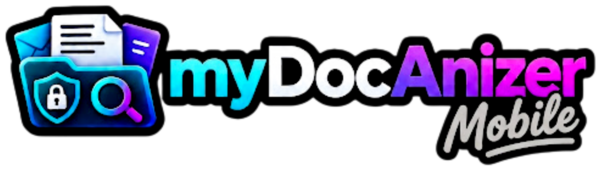
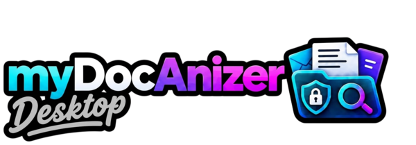

<div align="center">
  <a href="https://github.com/MrLongNight/myDocAnizer_Mobile">
    
  </a>
</div>

The Privacy-First, 100% On-Device Document Management & Smart Scanner App

**Version:** 2.8.0 (Build 2026.10)  
**License:** GNU Affero General Public License v3.0 (AGPLv3) for source code; All branding, logos, trademarks & store assets copyright mr.locke84.  
**Repository:** https://github.com/MrLongNight/myDocAnizer_Mobile  
**Desktop:** https://github.com/MrLongNight/myDocAnizer-Desktop  
**Architecture:** Kotlin / Jetpack Compose / Android Room (SQLite + FTS4) / Google ML Kit Offline OCR / 4-Team On-Device GGUF Nano-LLM Pipeline / Quality Gatekeeper & Text-Anchor Verification / AES-256-GCM Zero-Knowledge Client-Side Encryption / P2P Direct WiFi Sync

## Related project

<div align="center">
  <a href="https://github.com/MrLongNight/myDocAnizer-Desktop">
    
  </a>
</div>

**🖥️ myDocAnizer Desktop** is the cross-platform companion for Windows, macOS, and Linux. It brings the same smart document workflow to the desktop with advanced management features, helping you organize, manage and securely access your scanned documents.  
→ https://github.com/MrLongNight/myDocAnizer-Desktop

---

## 1. Mission & Philosophy

myDocAnizer-Mobile is the counter-design to commercial scanner apps with opaque cloud uploads, expensive subscription traps, and tracking.

### Core Promises

- **100% PRIVACY & GDPR:** No scanned document and no OCR text ever leaves your smartphone unencrypted.
- **ZERO-CLOUD AI:** The app uses exclusively on-device AI models (quantized GGUF weights via HuggingFace) and offline OCR via Google ML Kit.
- **0 € TOKEN COSTS:** Neither users nor developers incur ongoing API costs from OpenAI, Google Cloud, or Anthropic.
- **ZERO-KNOWLEDGE ENCRYPTION:** Backups and optional cloud backups (WebDAV, Nextcloud, Google Drive) are encrypted locally on the device via AES-256-GCM and PBKDF2 (100,000 iterations). Only the owner can read them.
- **TRANSPARENT MONETIZATION:** An honest hybrid model of free community access, modular lifetime one-time purchases, and fair monthly/project passes without lock-in.

---

## 2. System Architecture & Modules

```
+------------------------------------------------------------------------------+
|                             myDocAnizer-Mobile                               |
+------------------------------------------------------------------------------+
| 1. Dokumenten-Tresor (DMS)  | 2. Scanner & OCR        | 3. 4-Team On-Device  |
|   • DIN-Ordner (A01 - A09)  |   • Offline ML Kit OCR  |     KI-Pipeline      |
|   • Batch-Inbox für Scans   |   • Auto-B/W Threshold  |   • Team 1: Triage   |
|   • Custom Fields (Zusatz)  |   • Multi-Page Capture  |   • Team 2: Fachabtl.|
|   • FTS4 Volltext-Suche     |   • Akustische Profile  |   • Team 3: Stammdat.|
|   • Ordner-Strategie Wizard |   • GBNF-Grammar JSON   |   • Team 4: Revision |
+-----------------------------+-------------------------+----------------------+
| 4. Fristen & Regeln         | 5. Finanzen & Bank      | 6. Sync & Sicherheit |
|   • Kündigungsfrist-Regex   |   • CSV Kontoauszüge    |   • P2P WLAN-Sync    |
|   • Schlagwort-Regelwerk    |   • Belegabgleich       |   • AES-256-GCM Enc  |
|   • Auto-Logo-Zuweisung     |   • Bar-Ausgabenbuch    |   • Biometrie/Passkey|
|   • Deterministisch $S $T   |   • Budget & KPIs       |   • Disaster Restore |
+------------------------------------------------------------------------------+
```

### Module Details

**Module 1: Document Vault (DMS Explorer) & Dynamic Folder Wizard**
- Structured two-level folder hierarchy (main categories A01–A09: e.g., Housing, Finance, Contracts, Taxes, Authorities; subcategories B1.01, etc.).
- **Dynamic Folder Strategy Wizard (`FolderStrategy`):** Customizable Level-1 organizing structure:
  - *By Sender (Companies)*: `Vodafone/Invoices`
  - *By Category (Life Areas)*: `Finance/Insurance`
  - *Chronological (Year)*: `2026/Invoices`
  - *Flat*: `Documents`
- Batch Inbox for fast scanning in batches with later review and assignment.
- Custom additional fields (e.g., customer number, license plate, tax ID, meter number) with free type definition (text, amount, date, boolean, selection).
- Integrated PDF viewer with sharing, export, and print functions.

**Module 2: Smart Camera Scanner & Preprocessing**
- 100% offline text recognition with Google ML Kit.
- Automatic lighting check, skew detection, and straightening.
- Dynamic B/W threshold filter for high-contrast, crystal-clear text.
- Multi-page document capture with sorting and page deletion.
- Acoustic sound profiles (click, beep, chime, silent) and haptic feedback.

**Module 3: 4-Team On-Device KI-Pipeline & Quality Gatekeeper**
- Complete on-device inference without internet (GGUF weights via Llama.cpp / GBNF Hardware Grammars).
- **Team 1: Poststelle & Eingangstriage:** Fast first run on header & signal text slices (`OcrPreFilterMatrix`) for sender, doc-type and category.
- **Team 2: Fachabteilungs-Teams (Second Run):** Specialized departments (Team Finance, Team Contracts, Team Administration) with injected `FolderStrategy` prompts.
- **Team 3: Master Data & Whitelist Manager:** Injects vault-wide custom fields to eliminate synonym chaos.
- **Team 4: Revision & Quality Gatekeeper:** Pure Kotlin deterministic cross-check. Text-anchor verification for amounts, dates, and IBANs; normalization of currency (`1.000,00 €` -> `1000.00`) and dates (`12. März` -> `12.03`); birth date confusion prevention; 1-click UI corrections.

**Module 4: Deadline & Termination Detection & Deterministic Rule Engine**
- Automatic analysis of OCR text for termination periods, minimum contract durations, payment terms, and objection deadlines.
- Pre-warning times with calendar integration and dashboard alerts.
- **Deterministic DocRule Engine:** Auto-names rules strictly as `"$Sender $DocType"`, attaches target folder paths, and matches incoming scans 100% deterministically.

**Module 5: Finance, Household Budget & Receipt Reconciliation**
- CSV import for common German banks.
- Automatic receipt reconciliation with account entries.
- Integrated household budget with cash tracker.

**Module 6: Synchronization & Data Security**
- Local P2P master-master WiFi sync between phone and desktop (Port 8765, mDNS discovery, QR-Code pairing).
- Client-side zero-knowledge encryption with AES-256-GCM and PBKDF2 (100,000 rounds).
- Disaster recovery via encrypted `.enc` archives.
- App lock via biometrics and FIDO2 passkey.

---

## 3. Pricing Model & Monetization Strategy

### A) LIFETIME (One-time purchase)
- **Community / Free:** 0,00 €
- **Smart Vault:** 14,99 €
- **Local AI & Rules:** 29,99 €
- **Ultimate Suite:** 44,99 €

### B) PROJECT-PASS (Flexible subscription)
- **Monthly Pass:** 3,49 € / month
- **3-Month Pass:** 7,99 € one-time

### C) TRANSPARENT EXAMPLES
- Move & apartment change: 2 months = 6,98 €
- Tax return: 1 month = 3,49 €
- Long-term users: lifetime becomes more economical from month 13 onward

### D) FAIR-USE & NO DATA LOCK-IN
- When a monthly pass expires, all previous documents and data remain readable, searchable, and exportable.
- Gating affects only ongoing new scans, LLM re-evaluations, and P2P sync.

---

## 4. Build & Development Instructions

### Requirements
- Android SDK Version 34
- Java JDK 17 or 21
- Gradle 8.5+ (Kotlin DSL)

### Build Project
```bash
gradle assembleDebug
```

### Run Local JVM & Robolectric Tests
```bash
gradle :app:testDebugUnitTest
```

### Important Guidelines
- Never use `gradle clean` routinely.
- Run `gradle :app:testDebugUnitTest` after each change.

---

## AI implementation status and verification

The local AI stack is implemented in stages; the existence of a component is not proof that every feature is fully model-driven or verified on a physical device.

- **Native runtime:** llama.cpp/GGUF is built for `arm64-v8a` and `x86_64`. The current native configuration is **CPU-only**; Vulkan acceleration is disabled. Other ABIs use a JNI stub and the non-LLM fallback path rather than native GGUF inference.
- **Honest fallback reporting:** deterministic rules and heuristics are useful backup paths, but their output must not be presented as output generated by a local model. A benchmark is measured only when native local inference actually ran; catalog speed, hardware-tier and quality values are estimates unless explicitly measured.
- **Verification boundary:** GitHub Actions can verify the checks included in a particular run. A successful build does **not** prove successful GGUF inference, memory behavior or installation on a physical device.
- **Known open work:** end-to-end model-driven rule generation/refinement, model-driven tool calling, propagation of native timing/token metrics into benchmark results and real-device inference tests remain tracked tasks.

See [the live LLM implementation plan](docs/LLM_NATIVE_PRODUCTION_PLAN.md), [LLM functions and process documentation](docs/LLM_FUNKTIONEN_UND_PROZESSE_DOKUMENTATION.md), and [coding-agent rules](docs/coding-agent_documentation.md).

---

## 5. License, Trademarks & Open Source

The source code of myDocAnizer-Mobile is licensed under the GNU Affero General Public License v3.0 (AGPLv3).

The name "myDocAnizer", "myDocAnizer-Mobile", logos, icons, and Play Store graphic assets are copyrighted property of the author (mr.locke84). Everyone is entitled to view, audit, and create their own builds for personal use. Official Play Store distribution and official trademark branding remain with the project owner.
