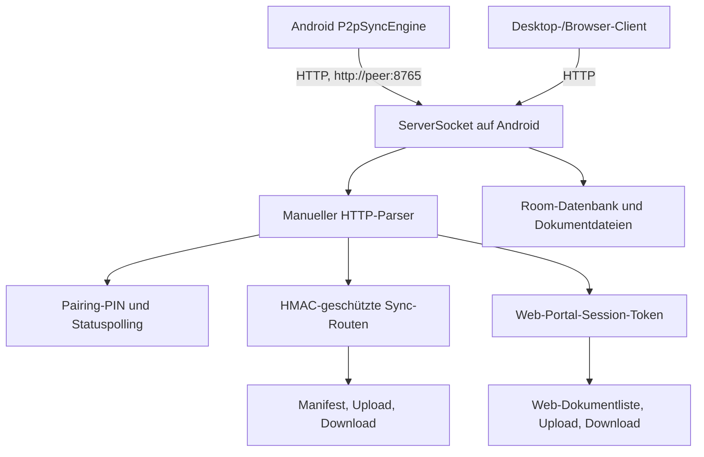

# P01 – P2P-Protokoll-Audit und Transport-ADR

**Stand:** 2026-10-19  
**Status:** Audit dokumentiert; keine Protokollimplementierung vorgenommen.  
**Entscheidung:** **P02/P03 bleiben blockiert**, bis diese ADR ausdrücklich freigegeben und die Desktop-/Browser-Kompatibilität entschieden wurde.

## 1. Datenfluss (Ist-Zustand)

## 2. Bestätigte Befunde

### Transport und Listener

- `P2pSyncServer.startServer()` erstellt `java.net.ServerSocket(port)`. Es wird kein `SSLServerSocket`/TLS-Context verwendet.
- `P2pSyncEngine` baut Status-, Pairing-, Manifest- und Datei-Requests mit `http://` auf. Ein TLS- oder Zertifikats-Pinning-Pfad ist dort nicht implementiert.
- Der Server akzeptiert Verbindungen und prüft danach die Quell-IP mit `isLocalIp`. Eine private/Loopback-IP-Prüfung ist kein kryptografischer Schutz: Geräte im selben oder falsch segmentierten lokalen Netz können den Klartextverkehr beobachten bzw. angreifen.
- Die Kommentare bezeichnen den Dienst als „TLS/AES-256“, doch für die Transportverbindung belegt der Code nur unverschlüsseltes HTTP. AES-GCM auf einzelnen Payloads ersetzt keine authentisierte Transportschicht.

### Pairing und Sync-Authentifizierung

- Das Pairing verwendet einen sechsstelligen PIN. Der Client fragt `/api/pair/status?requestId=...` per HTTP ab; bei Autorisierung wird das Shared Secret über diesen Pfad zurückgegeben. Damit ist das Geheimnis im Ist-Zustand nicht durch TLS vor einem lokalen Netz-Angreifer geschützt.
- Sync-Routen prüfen Signatur-, Zeitstempel- und Nonce-Header über `verifyAuth`. Das ist zusätzliche Request-Authentifizierung, aber kein Schutz der Vertraulichkeit des gesamten HTTP-Verkehrs.
- Die Serverinstanz hält autorisierte Tokens/Sessions in speicherinternen Collections. Das Session-/Pairing-Verhalten über Prozessneustart, Ablauf, parallele Anfragen und Wiederverwendung von Nonces muss in P04+ separat getestet werden; aus dem aktuellen Audit wird keine Replay-Sicherheit behauptet.
- Der Pairing-QR-Datenvertrag enthält `fingerprint` und `pubKey`, aber das Vorhandensein von Feldern beweist keine Verifikation. Im geprüften Android-Client wurde kein TLS-Pinning-/Fingerprint-Prüfpfad gefunden.

### HTTP-Parser und Endpunkte

- Der Server implementiert einen eigenen HTTP-Parser. Header werden bis zu 64 KiB gesammelt; Content-Length wird auf maximal 100 MiB begrenzt. Die Grenzen sind ein erster Schutz, ersetzen aber keinen etablierten HTTP-Stack. Chunked Transfer, ungültige/duplizierte Header, zu kurze Bodies, lange Header und viele parallele Verbindungen benötigen gezielte Negativtests.
- Endpunkte umfassen unter anderem `/`, `/index.html`, `/portal`, `/cert/mydocanizer-ca.crt`, `/api/web/auth`, `/api/web/documents`, `/api/web/upload`, `/api/web/download`, `/api/pair/request`, `/api/pair/status`, `/api/sync/exchange_manifest`, `/api/sync/download_file`, `/api/sync/upload_file` und Desktop-/Scanner-Routen.
- JSON-Antworten setzen `Access-Control-Allow-Origin: *` und `Access-Control-Allow-Headers: *`. Das ist für einen lokalen Webserver eine breite Freigabe. Zusammen mit HTTP und lokal erreichbaren Dokument-/Upload-Routen erhöht das Risiko von Cross-Origin-Aufrufen durch Webseiten, die der Nutzer im Browser öffnet.
- Web-Session-Tokens können sowohl über den Header `x-session-token` als auch über den Queryparameter `token` angenommen werden. Query-Tokens können in Browserhistorie, Diagnose-/Serverlogs oder Referer-Kontext gelangen; künftig ausschließlich Header verwenden.
- Der Upload-Pfad vertraut auf Client-Metadaten wie Dateiname/Flag `x-encrypted` und optionale Prüfsumme. Eine Prüfsumme beweist keine Authentizität/Vertraulichkeit. Die Bedeutung und Validierung von Dateiformat, Pfad, Verschlüsselungsstatus und Commit müssen in separaten Transfer-APs geprüft werden.

### CA-/Browserportal

- `/cert/mydocanizer-ca.crt` liefert aktuell den String aus `P2pSyncSecurityService.getLocalRootCaPem()`. Der Quelltext enthält offensichtlich Platzhalter-/verkürzte Zertifikatsdaten; dies ist kein Beleg für ein gültiges, pro Installation erzeugtes Zertifikat.
- Ein Zertifikat über denselben unverschlüsselten HTTP-Server bereitzustellen schafft keinen sicheren Bootstrap-Vertrauenskanal.
- Das Browserportal läuft aktuell über denselben Klartext-HTTP-Listener und setzt breite CORS-Header. „Zero-Knowledge“ clientseitige Payload-Verschlüsselung löst weder die Authentizität des Servers noch Manipulation von Portal-JavaScript über HTTP.

## 3. Transport-ADR (Vorschlag, Freigabe erforderlich)

### Android-zu-Android / nativer Desktop-Client

1. Pro Installation ein langlebiges, nicht exportierbares oder geschützt gespeichertes Server-Schlüsselpaar und ein selbstsigniertes Serverzertifikat erzeugen; keine eingebetteten statischen Zertifikate oder Platzhalter.
2. Beim Pairing den SHA-256-Fingerprint des Zertifikats über einen unabhängigen, vom TLS-Kanal getrennten Vertrauenskanal anzeigen und bestätigen (z. B. QR auf dem Host plus expliziter Vergleich auf dem Client). Ein PIN allein authentisiert kein Zertifikat.
3. Danach ausschließlich HTTPS/TLS akzeptieren. Unbekannter oder geänderter Fingerprint muss abbrechen; kein HTTP-Fallback. Zertifikatswechsel erfordert bewusstes erneutes Pairing.
4. HTTP-Parser nicht weiter ausbauen: bevorzugt einen etablierten HTTP-Server-Stack hinter TLS verwenden; falls ein eigener Parser beibehalten wird, sind dessen Grenzen und vollständige Negativtests Freigabekriterien.
5. Tokens nur in Headern transportieren; Pairing-/Session-Geheimnisse zeitlich begrenzen, einmalige Challenges/Nonces serverseitig gegen Wiederverwendung speichern und bei Stop/Lock/Unpair widerrufen.
6. CORS auf konkrete Ursprünge und erforderliche Header/Methoden begrenzen. Für native Clients ist CORS nicht erforderlich.

### Browserportal – separate Entscheidung

**Vorschlag: Browserportal standardmäßig deaktiviert lassen, bis ein eigener sicherer Trust- und Origin-Plan freigegeben ist.** Browser können App-eigenes Zertifikat-Pinning nicht wie der native Client automatisch durchsetzen. Für eine spätere Freigabe sind ein vom Browser vertrauenswürdiges HTTPS-Zertifikat oder ein bewusstes, nachvollziehbares Zertifikatsvertrauen sowie restriktive Origin-/CORS-Regeln und Schutz vor Cross-Site-Requests erforderlich. Ein Zertifikat-Download über den bestehenden HTTP-Listener reicht nicht.

## 4. Gates und Folgearbeit

- **P02 blockiert:** Server-TLS erst nach Freigabe der ADR; Listener darf nicht auf Klartext zurückfallen.
- **P03 blockiert:** nativer Client-TLS/Fingerprint-Pinning erst nach P02 und nachdem Pairing den Fingerprint zuverlässig über den zweiten Vertrauenskanal bestätigt.
- **Browserportal-Gate offen:** vor Implementierung entscheiden, ob Browserportal sicher unterstützt oder entfernt/deaktiviert wird.
- **Weitere Audits:** Session-Lifetime/Lock-Verhalten, Nonce-Replay, Upload-Pfad-/Dateitypvalidierung, Content-Length/Parser-Negativtests und parallele Verbindungen bleiben separate Testaufgaben.

## 5. Verifikation

- [x] Server-Socket- und HTTP-Clientpfade geprüft.
- [x] Pairing, Auth-Header, Portal-/CORS- und CA-Endpunkte im Quellcode geprüft.
- [x] Risiken und vorgeschlagene Architektur dokumentiert.
- [ ] ADR durch Projektverantwortliche freigegeben.
- [ ] Keine TLS-/Protokolländerung in P01 implementiert.
